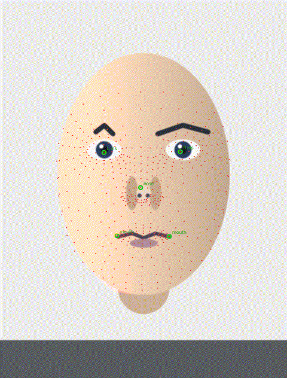
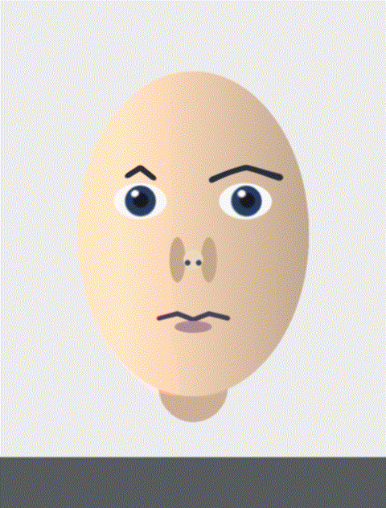

# 人脸滤镜 / 美颜：从摄像头到像素

「手机摄像头识别人脸做滤镜」拆开只有三步，难易极不平均：

```
① 检测人脸框   →  ② 在框里定位关键点   →  ③ 拿关键点去动像素
   几毫秒            几毫秒                    几十毫秒 ← 真正的战场
```

本机实测（CPU）这一结论：**①+② 合计 10.3 ms，③ 单独做要 97.6 ms**。
把 ③ 限制在人脸/眼球的小区域里，降到 7.4 ms —— **13.2 倍**。
所以一篇讲「人脸滤镜怎么实现」的文章，重点应该在这里，而不是模型选型。


> 本目录所有实验都用这张**程序化合成**的脸（[make_test_face.py](scripts/make_test_face.py)
> 画的：皮肤渐变 + 眉眼鼻嘴 + 噪点模糊）。不用真人照片 —— 滤波器不关心画的是谁，
> 但仓库不该替你决定「谁的脸可以拿来当素材」。

## 一、检测与关键点

### 检测器

| 方案 | 特点 | 用在哪 |
| --- | --- | --- |
| **BlazeFace** | 亚毫秒级（GPU），专为移动端设计；MediaPipe 里短距/长距两个模型分工 | MediaPipe / ML Kit（Android/iOS）的默认选择 |
| SCRFD | 精度更高，多尺度，anchor-free；`buffalo_l` 里的 `det_10g` 就是它 | insightface 生态、换脸流水线 |
| RetinaFace | 老牌精度标杆，5 点 + 框一起出 | 离线/服务端 |
| YOLOv5-face / YOLOv8-face | 通用检测器改的，工程生态好 | 有 GPU 的自建方案 |

手机端的事实标准是 **MediaPipe（Android/iOS/Web 都有）**，所以下面的关键点也按它讲。

### 关键点：478 个点，和 52 个表情系数

MediaPipe FaceLandmarker 一次输出两样东西：

- **478 个 3D 关键点** = 468 点的面部网格 + 10 个虹膜点（每只眼 5 个，含瞳孔中心）
- **52 个 blendshape 系数**：和 **ARKit** 的 52 个表情参数同构（`mouthSmileLeft`、
  `browDownLeft`、`eyeBlinkRight`…），值域 0~1

这两样是分开用的：

- **要改形状**（大眼、瘦脸、口红）→ 用 478 个点
- **要改表情或做驱动**（贴纸跟着笑、虚拟形象同步）→ 用 52 个系数，因为它已经
  把「笑到什么程度」抽象成了一个标量，不用自己从点算



实测这张合成脸上，最强的三个系数是 `mouthPucker 0.908`、`eyeWideRight 0.451`、
`eyeWideLeft 0.393` —— 和画的时候嘴画得比较小、眼睛画得比较大是对得上的。
这里也顺便说明了一件事：**blendshape 输出是可验证的**，画一张知道表情的脸就能对账。

> 移动端还有一条并行的路：**ARCore Augmented Faces**（Android）给 468 点 + 3 个
> 区域网格（鼻、额头、脸颊），适合做贴纸/面具；iOS 侧是 ARKit 的 1220 点 face mesh。
> 跨平台项目通常把「关键点 → 自己的一套标准点位」做一层归一化。

## 二、拿到关键点之后做什么

### 1. 局部变形（大眼、瘦脸、微笑嘴）

本质都是**逐像素重映射**：为每个像素算一个新的采样坐标，然后去原图取色。
大眼是最小可用的例子 —— 把眼球中心当圆心，半径内按权重往外取样：

```python
t   = clip(|p - center| / R, 0, 1)
w   = (1 - t*t)**2                  # 圆心 1，半径处 0（平滑衰减）
scale = 1 - strength * w            # 采样半径缩放，<1 就是"往外取样"= 放大
new_p = center + (p - center) * scale
```

两个细节决定成败：

- **权重必须在半径处归零**。这样圆外保持原图，**没有硬接缝**（否则下巴上会有一圈亮线）。
- **只算包围盒**。上面的 `p` 如果对整个 760×1000 的图像算一遍，就是 97.6 ms；
  只算眼球周围那一小块，7.4 ms。



更复杂的效果是同一套东西加更多控制点：

| 效果 | 做法 |
| --- | --- |
| 瘦脸 | 在下颌线上取若干控制点，向里推；用移动最小二乘（MLS）或三角剖分 + 仿射，避免局部扭曲 |
| 磨皮 | **高-低频分离**：高斯模糊得到低频，原图减低频得到高频（毛孔/斑），把高频按肤色掩码压掉再合回去。比直接模糊保细节 |
| 美白 | 肤色掩码（YCbCr 阈值）+ 亮度曲线，避免把背景一起提亮 |
| 口红 / 眉毛贴图 | 用口部/眉部的点做三角剖分，把贴图按三角形仿射映射进去 |

### 2. 时序稳定

逐帧独立算关键点，脸会「抖」。工程上的三招：

1. **EMA 平滑**：`p_t = α·p_raw + (1-α)·p_{t-1}`，α 取 0.3~0.6，便宜有效
2. **光流跟踪**：帧间用 Lucas-Kanade 跟点，只在跟丢时重新检测
3. **只在关键点变化超过阈值时才重算变形网格** —— 人不动的时候一帧都不该算

### 3. 遮挡

真滤镜要处理「手挡住脸」「头发飘过来」。常见做法：

- 有深度时写 `gl_FragDepth`，让遮挡物和脸的深度自然分胜负
- 没有深度时给脸生成**掩码**（人脸分割模型），掩码外不做滤镜
- 眼镜/口罩这类固定遮挡物，直接用预置的贴图区域

## 三、实测

固定环境：760×1000 合成脸，CPU，MediaPipe FaceLandmarker（float16），
20 次取平均。脚本 [face_landmark_filter.py](scripts/face_landmark_filter.py)。

| 阶段 | 耗时 | 说明 |
| --- | --- | --- |
| 检测 + 478 点 + 52 系数 | **10.3 ms** | 一次调用全给你 |
| 大眼变形（**全图**重映射） | **97.6 ms** | 760000 像素全部过一遍 `remap` |
| 大眼变形（**ROI** 重映射） | **7.4 ms** | 只算眼球包围盒 → **13.2×** |
| 端到端（检测 + ROI 变形） | **17.7 ms** | → **56 fps** |
| 若每帧再留 20 ms 做别的 | 37.7 ms | 仍够 30 fps |

```bash
python scripts/face_landmark_filter.py face.png face_landmarker.task out/
```

## 小结

1. **模型不是瓶颈。** 检测 + 关键点在 10 ms 量级，一整帧的预算是 33 ms（30fps）。
   把省下来的时间花在哪，决定滤镜做得动不动起来。
2. **ROI 是命门。** 同一个变形算子，全图和 ROI 差 13.2 倍。手机上的做法更极端：
   把变形扔进 GPU shader，整条链路的 CPU 占用接近 0。
3. **别自己造关键点模型。** 478 点 + 52 系数是现成的跨平台标准，自己训一个
   只会得到一个更差的版本。真正的自研价值在效果层（怎么用这些点）。
4. **滤镜是「一次检测 + 每帧变形」。** 关键点不需要每帧都重新检测，
   `detect → 平滑 → 变形` 拆成不同频率的三段，这才是移动端稳住帧率的方式。

往下走：[02-face-swap.md](02-face-swap.md) 用同一套关键点（但只用 5 个）做换脸。
