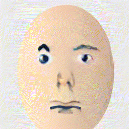
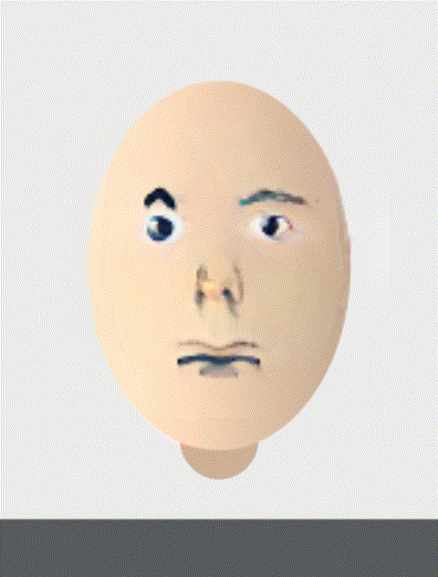

# 换脸：一条跑通的流水线

换脸听起来玄，拆开其实只有四件事，其中三件是现成的：

```
人脸图 ──检测5点──▶ 相似变换对齐 ──▶ 身份编码（ArcFace） ──▶ 换脸网络 ──▶ 贴回原图
           ①              ②                  ③                 ④            ⑤
```

**难点在 ②**。⑤ 的观感也全靠 ②。①③④ 都是调库。

本文按这条线走一遍，数字来自一条在本机 CPU 上真跑通的流水线
（[face_swap_pipeline.py](scripts/face_swap_pipeline.py)），用的是**自换脸**
（源 = 目标 = 同一张图），目的只是验证每一步都通、贴回不糊边。

## 一、对齐：5 个点定生死

### 为什么是 5 个点

所有主流人脸识别/换脸模型都吃**同一张 112×112 的归一化脸**，位置由 **ArcFace 的
五点位模板**规定：

```python
ARCFACE_DST_112 = [[38.2946, 51.6963],   # 左眼
                   [73.5318, 51.5014],   # 右眼
                   [56.0252, 71.7366],   # 鼻尖
                   [41.5493, 92.3655],   # 左嘴角
                   [70.7299, 92.2041]]   # 右嘴角
```

有了这 5 个点在原图里的坐标，用 `cv2.estimateAffinePartial2D`（**相似变换**：
旋转 + 等比缩放 + 平移，**不含剪切**）就能求出变换矩阵。用 `LMEDS` 是为了抗离群点。

> 为什么是相似变换而不是仿射？因为人脸不该被压扁。仿射有 6 个自由度，会把
> 一张圆脸拉成椭圆脸；相似变换 4 个自由度（缩放、旋转、x/y 平移），形状不变。

### 用虹膜中心，不用眼角

模板里的「眼」是**瞳孔位置**，所以取点也该取**虹膜中心**（MediaPipe 的 468 / 473）
而不是眼角。原因：眼角位置会被**眨眼和眼皮**带着动，虹膜中心基本不动。

```python
eyes  = sorted([pts[468], pts[473]], key=lambda p: p[0])   # 按 x 排序
mouth = sorted([pts[61],  pts[291]], key=lambda p: p[0])   # 按 x 排序
```

**必须按 x 排序**：MediaPipe 的点位命名左右约定和 ArcFace 模板未必一致，
排一次序就把这个不确定性消掉了（谁在左边就是模板的第 0 个）。

## 二、身份向量与 emap

### ArcFace 给的是「这是谁」，不是「长什么样」

身份编码器（`w600k_r50.onnx`，InsightFace `buffalo_l` 里的识别模型）把一张对齐好的
112×112 人脸压成 **512 维向量**。同一个人不同照片的向量距离近，不同人距离远。
它的输入规范是固定的：

```python
blob = cv2.dnn.blobFromImage(face112, 1/127.5, (112,112),
                             (127.5,127.5,127.5), swapRB=True)   # BGR→RGB, mean/scale=127.5
```

### emap：把「身份」转成「风格」

换脸网络的中间层用的是 **AdaIN**（自适应实例归一化）—— 它不接收 512 维身份向量，
而是接收一组风格统计量。两者之间的桥是一个 **512×512 的矩阵**，业界叫 `emap`。

妙的是它藏在哪：inswapper 把它当 **initializer** 塞进 onnx 文件里，而且**没人用它**，
推理时根本不碰。所以拿 onnxruntime 是找不到它的，得直接翻 protobuf：

```python
for t in onnx.load(path).graph.initializer:
    if list(t.dims) == [512, 512]:      # 按形状找，比记名字稳
        emap = numpy_helper.to_array(t) # 本机实测：名叫 buff2fs，min=-0.842 max=0.784
```

然后：

```python
unit   = emb / np.linalg.norm(emb)      # ① 先单位化
latent = unit @ emap
latent = latent / np.linalg.norm(latent) # ② 再单位化
```

**两步归一化都不能省。** 身份向量本身模长在 20 上下（实测 25.1），拿它直接去投影，
AdaIN 的风格强度会被放大 20 倍，贴回原图是一张花脸 —— 这是本目录踩过的坑之一。
在自换脸场景下回头看，这个 bug 的特征很明显：脸是对的，颜色是彩虹。

## 三、换脸网络

`inswapper_128.onnx` 的接口简单到不像话：

| 输入 | 形状 | 含义 |
| --- | --- | --- |
| `target` | 1×3×**128**×128 | 对齐后的目标脸（不是 112！） |
| `source` | 1×512 | 上面那个归一化后的 latent |
| 输出 | 1×3×128×128 | 换好的脸 |

推理：

```python
swapped = sess.run(None, {"target": target_blob, "source": latent.reshape(1,-1)})
```

它就是 **encoder-decoder + AdaIN**：encoder 把目标脸压进隐空间，AdaIN 用 latent
调制中间特征（把「这是谁」注入进去），decoder 重建出带源身份的 128×128 脸。

### 同类方案的地图

| 方案 | 架构 | 特点 |
| --- | --- | --- |
| **inswapper_128** | encoder-decoder + AdaIN，**一次前向** | 不需要针对每个人训练，一个模型换所有人；泛化好、速度快，代价是分辨率 128 |
| **DeepFaceLab** | **A/B 双 decoder**（共享 encoder，各练一个解码器） | 效果上限更高、可到高清，但**每换一个人要训一次模型**（数小时~数天） |
| **SimSwap** | 加了 **IIM**（identity injection module） | 把身份向量按通道注进 bottleneck，是 inswapper 思路的先驱 |
| **MobileFaceSwap** | 轻量化（论文报 0.5M 参数、~26 fps） | 面向手机端，但生态和权重远不如前两者 |

一句话：**想开箱即用选 inswapper，想极致效果选 DeepFaceLab（并付出训练成本）。**

## 四、贴回原图

换脸网络只给你 128×128 一张脸，剩下的事全在贴回：

1. **逆变换**：用对齐矩阵的逆 `cv2.invertAffineTransform` 把 128 脸映回原图尺寸
2. **掩码**：椭圆 + 高斯羽化（`GaussianBlur(σ≈8)`），边缘才不会有一圈硬边
3. **按掩码混合**：`out = warped*mask + frame*(1-mask)`
4. **Poisson 融合**：`cv2.seamlessClone(..., NORMAL_CLONE)` 按边界梯度对齐色差，
   把「贴上去的脸」和「原来的脖子/背景」的亮度差抹平

第 4 步本机实测耗时在 **66~158 ms** 之间浮动 —— 它和掩码包围盒大小强相关，
是这条流水线里最容易被忽略的开销（在人脸只占画面很小一块时才会便宜）。

## 五、实测

固定环境：760×1000 合成脸，CPU，自换脸。脚本
[face_swap_pipeline.py](scripts/face_swap_pipeline.py)。

| 阶段 | 耗时 | 占比 |
| --- | --- | --- |
| ① 检测 5 点 | 25.4 ms | 2% |
| ② 对齐（112 给识别 / 128 给换脸） | 5.5 ms | 0.5% |
| ③ ArcFace 身份向量 | 43.8 ms | 4% |
| ④ emap 投影 + 归一化 | **0.4 ms** | ~0% |
| ⑤ **换脸网络推理** | **918.7 ms** | **80%** |
| ⑥ 贴回原图（含 Poisson） | 158.3 ms | 14% |
| **合计** | **1152 ms** | → **0.87 fps** |

两件事值得注意：

- **④ 只花 0.4 ms。** 「把身份转成风格」这个看起来最神奇的操作，实际就是一个
  512×512 矩阵乘法。真正贵的永远是卷积网络。
- **⑤ 占 80%。** 这就是为什么换脸在 CPU 上只有 1 fps、而上了 GPU 能到几十 fps ——
  优化只要优化这一项，别的地方省不出东西来。所有「实时换脸」的演示都是 GPU 版。




> 输出看着不像「同一个人」是正常的：源图是画的卡通脸，换脸网络是在真人脸上训的，
> 它会把卡通五官「脑补」成真人五官。这里要验的是**流水线通不通、贴回糊不糊边**，
> 不是效果好不好。

## 六、要动起来的两个前提

### 时序稳定

逐帧独立换脸会有三处抖：闪烁、漂移、五官跳。工程解法：

| 问题 | 解法 |
| --- | --- |
| 整体闪烁 | 对 latent 做 EMA（`latent_t = α·latent_raw + (1-α)·latent_{t-1}`），身份不该逐帧变 |
| 五官漂移 | 关键点平滑（同 [01](01-face-filters.md)），对齐矩阵稳了输出就稳 |
| 遮挡穿插 | 人脸跟踪 ID（同一张脸才复用 latent），别让两张脸的身份串台 |
| 生成噪声 | 固定随机种子 / 用确定性推理；必要时每隔 N 帧做一次关键帧对齐 |

### 性能

按上表，要实时（≥25 fps）就得把 ⑤ 从 919 ms 压到 40 ms 以内 —— **必须 GPU**。
剩下的 ①②③⑥ 加起来的 ~230 ms 也不可忽略，其中 ⑥ 是最值钱的优化点。

## 七、许可与边界（务必读）

- **代码 MIT ≠ 权重可用**：inswapper_128 / buffalo_l 的权重**只授权非商业研究用途**。
  商用需要另行获得授权（原商业版本是 InsightFace 的付费服务）。
- **模型许可 ≠ 肖像权**：拿真人的脸做换脸，在几乎所有司法辖区都涉及**肖像权**，
  中国还有专门的《民法典》第 1019 条。这跟模型许可是两件独立的事，两个都合规才行。
- 本目录的实测因此只用**程序化合成的人脸**，且只做自换脸。

## 小结

1. 换脸 = **对齐 + 身份注入 + 贴回**。中间那个网络是可替换的零件，对齐才是灵魂。
2. **虹膜中心 > 眼角**，**按 x 排序**消掉左右歧义 —— 这两个细节决定了脸正不正。
3. **两步归一化不能省**（先单位化 → 投影 → 再单位化），否则是花脸。
4. **emap 藏在 onnx 的 initializer 里**，按形状 `[512,512]` 找，别记名字。
5. 时间几乎全花在换脸网络上（80%），CPU 上 1 fps 是正常的，实时必须上 GPU。

接着看声音：[03-voice-pitch-and-formant.md](03-voice-pitch-and-formant.md)。
