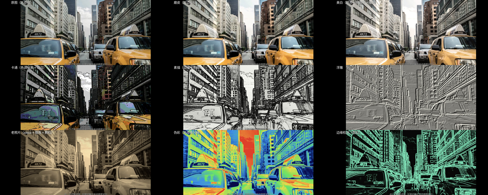
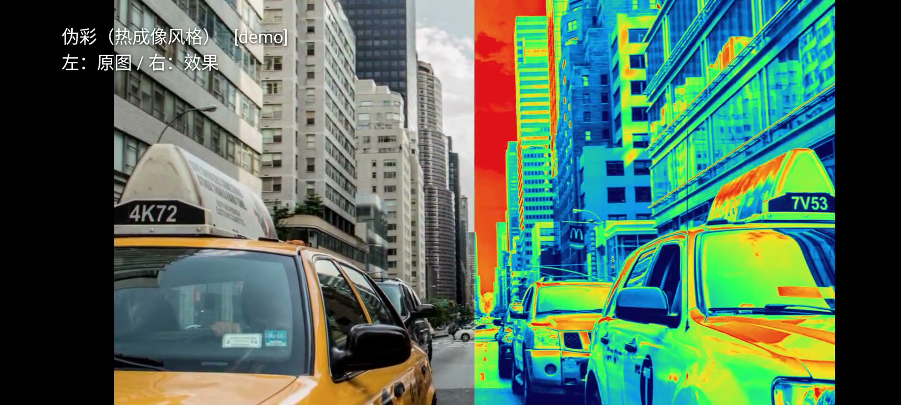

# 滤镜搬到 GPU：Camera2 → SurfaceTexture → 着色器

[01-face-filters.md](01-face-filters.md) 的结论是「CPU 逐像素做全图变形，97.6 ms/帧」。
那手机上的美颜相机凭什么 30 fps？答案不是更快的 CPU，而是**根本不回读像素**：

摄像头帧和解码后的视频帧都作为 **GL 外部纹理（OES）** 直接进 GPU，
滤镜是 fragment shader，输出直接贴到窗口 surface 上。整条链路上 CPU 只发命令，
碰不到一个像素。

这一篇是把这条链路在真机上跑起来，并量出每个效果的**单帧 GPU 时间**。

| 项 | 值 |
| --- | --- |
| 设备 | Google Pixel 6（Tensor GS101，ARM Mali-G78） |
| 屏幕 | 1080 × 2400，60 / 90 Hz 两档 |
| GL 表面 | 2272 × 1080（横屏时挖孔占掉一条，见下） |
| 系统 | Android 14 |
| 图形 API | OpenGL ES 2.0（`GLSurfaceView` + `GL_TEXTURE_EXTERNAL_OES`） |

## 一、链路

```
 Camera2 重复请求                  MediaPlayer 解码（素材模式）
      │ Surface                         │ Surface
      └──────────────┬──────────────────┘
                     ▼
             SurfaceTexture
                     │  ← 零拷贝：帧还在 GPU 显存里，没有 glTexImage2D
                     ▼
        GL_TEXTURE_EXTERNAL_OES   （采样时由驱动做 YUV → RGB）
                     │
                     ▼
        fragment shader：if (uFilter == n) ...
                     │
                     ▼
              EGL 窗口 surface → 屏幕
```

三个和「正常纹理」不一样的地方：

1. **必须用外部纹理。** 相机和视频解码器吐出的是 YUV / 厂商私有 tile 格式，
   不是标准 RGB，只有 `samplerExternalOES` 能在采样时让硬件实时转换。
   `glTexImage2D` 那条路要先把 YUV 拉回 CPU 再上传，正好把零拷贝毁掉。
2. **每一帧要 `updateTexImage()`。** 这是 OES 的隐式缓冲交换，不是普通纹理的绑定。
3. **`getTransformMatrix()` 只给你裁剪和翻转，不含旋转。** 相机 sensor 一般是横着装
   （rotation 90°），竖屏预览必须自己在顶点着色器里再转 90°，否则画面是躺着的。
   这个 4×4 矩阵很容易被误当成「万能变换」。

## 二、九个效果，一个 pass

一次 `glDrawArrays` 画满屏四边形，fragment shader 里按 `uFilter` 分支。
好处是链路最短（一次全屏绘制，没有 FBO 往返），坏处是每加一个效果，shader 里就多一段死代码。

| # | 效果 | 怎么算的 |
| --- | --- | --- |
| 0 | 原图 | 直接采样 |
| 1 | 磨皮 | 一圈 8 个方向采样，权重 `exp(-k·‖Δcolor‖²)` 做**双边近似**（颜色差大的邻居权重小 → 保边） |
| 2 | 美白 | 提亮 + 降饱和 + 暖调，按亮度 `smoothstep` 只压暗部不动高光 |
| 3 | 卡通 | 颜色量化到 5 级 + Sobel 边缘压黑 |
| 4 | 素描 | 1 − 边缘强度 当底色，乘上原图亮度做明暗 |
| 5 | 浮雕 | 对角两点亮度差 + 0.5 |
| 6 | 老照片 | sepia + 径向暗角 + 逐像素噪点 |
| 7 | 伪彩 | 亮度映射到 5 段色带（热成像风格） |
| 8 | 边缘 | Sobel 幅值 → 霓虹绿 |

磨皮那一段是整篇里唯一有「算法」的：

```glsl
vec3 sum = c; float wsum = 1.0;
for (int i = 0; i < 8; i++) {
  float a = float(i) * 0.7853982;          // 每 45°
  vec2  d = vec2(cos(a), sin(a)) * 3.5 * uTexel;
  vec3  s = S(uv + d);
  vec3  diff = s - c;
  float w = exp(-dot(diff, diff) * 14.0);  // 颜色越像，权重越大
  sum += s * w;  wsum += w;
}
```

注意 `uTexel = 1/纹理尺寸`：采样步长按**像素**给，不是按 UV 常数给，
否则换个分辨率磨皮强度就变了。

## 三、分屏对比：别用纹理坐标判断屏幕位置

演示要「左半屏原图 / 右半屏效果」，直觉是 `if (vTexCoord.x < 0.5)`。
这在实际链路上是错的：`vTexCoord` 已经被 SurfaceTexture 的变换矩阵和我自己加的
90° 旋转改过，它和屏幕位置没有对应关系（横竖屏、裁剪、镜像都会破坏）。

正确的做法是用 `gl_FragCoord`——它是窗口像素坐标，天然和纹理无关：

```glsl
float sx = gl_FragCoord.x / uRes.x;   // 0..1，屏幕从左到右
if (uSplit > 0.0 && sx < uSplit) outColor = c;   // 左半边显示原图
```

同理，暗角（vignette）也必须用 `gl_FragCoord / uRes`，不能用 UV——否则画面一旋转，
暗角跟着转到侧边去。

## 四、实测：单帧 GPU 时间

方法：每帧 `glDrawArrays` 之后立刻 `glFinish()`，`glFinish` 返回的时刻就是 GPU 真的画完的时刻
（`glFlush` 不算，它只把命令塞进队列）。每 60 帧取一次平均并打日志。

`2272 × 1080`，源视频 30 fps：

| 效果 | 整帧耗时（含呈现等待） |
| --- | --- |
| 原图 | 3.8 – 4.5 ms |
| **磨皮**（8 次采样双边） | **4.7 – 5.0 ms** |
| 美白 | 3.6 – 4.4 ms |
| 卡通 | 4.1 – 4.5 ms |
| 素描 | ~4.0 ms |
| 浮雕 | ~4.2 ms |
| 老照片 | ~4.1 ms |
| 伪彩 | ~3.9 ms |
| 边缘 | 3.7 – 4.7 ms |

读这张表要注意两件事，否则会得出错误结论：

1. **原图也要 ~4 ms。** 这 4 ms 是 `glFinish` 等到的「呈现完成」，属于固定开销
   （合成、vsync 对齐、屏幕刷新）。磨皮真正多出来的只有 **~0.7 ms**。
2. **帧率卡在 30 fps 不是 GPU 撑不住。** 那是源视频的帧率（`MediaPlayer` 只喂 30 帧/秒）。
   按 4 ms/帧算，GL 这一层的能力在 250 fps 量级【推算】，远没到瓶颈。

第一次统计窗口（上电后 2 秒）会包含 shader 编译，数字偏低到 2.0–2.3 ms 反而更好看——
那是假的，别采信；表里给的是稳态值。

## 五、素材模式：同一套 shader 吃视频文件

相机之外还有一个入口：`MediaPlayer.setSurface(new Surface(surfaceTexture))`，
解码出来的帧直接进同一个 OES 纹理，后面一行代码都不用改。

这顺带解决了一个工程问题：**做演示时不用举着手机对着实物**。
用一张高清图做一个 50 秒的慢推镜头（`zoompan`），压成 720p 塞进 `assets/`，
就能稳定复现「九个滤镜在同一段画面上的差异」。





上图左半屏是真的原图，右半屏是同一次绘制的滤镜结果——同一个 fragment shader 里
按 `gl_FragCoord.x` 分支，不是两张图拼的。

## 六、不用 gradle 的构建链

这个 App 只有 2 个 Java 文件、1 个 manifest、0 个资源文件，用不着 gradle：

```bash
aapt2 link -o build/base.apk -I $SDK/platforms/android-35/android.jar \
    --manifest AndroidManifest.xml -A assets \
    --min-sdk-version 21 --target-sdk-version 34

javac -source 8 -target 8 -classpath $SDK/platforms/android-35/android.jar \
    -d build/obj $(find src -name '*.java')

d8 --min-api 21 --lib $SDK/platforms/android-35/android.jar \
   --release --output build/dex $(find build/obj -name '*.class')

(cd build/dex && zip -j ../base.apk classes.dex)
zipalign -f -p 4 build/base.apk build/aligned.apk
apksigner sign --ks debug.jks --out build/app.apk build/aligned.apk
```

完整脚本见 [scripts/android-glfilter/build.sh](../scripts/android-glfilter/build.sh)，产物约 4.2 MB，其中 4.1 MB 是演示视频（`assets/demo.mp4`），代码和资源不到 100 KB。

## 七、踩到的坑

1. **`adb shell` 会吃掉脚本的剩余 stdin。** 它本来就是「把本地 stdin 转发给远端 shell」，
   所以在一个 ssh 脚本里写 `adb shell am start ...` 之后再写别的命令，后面的命令全被吃掉。
   每条 adb 命令后面加 `< /dev/null`。`ffmpeg` 同理（不加会进交互式命令模式，
   把后面的 `echo` 当成滤镜命令解析），要加 `-nostdin`。
2. **Android 11+ 分区存储：别拿裸文件路径读外部存储。** 把 mp4 推到
   `/sdcard/Movies/` 再用 `MediaPlayer.setDataSource("/sdcard/Movies/x.mp4")` 会 `EACCES`，
   即使 `ls -l` 看到 644、即使是 App 自己的 `Android/data/<pkg>/files/` 目录
   （用 `adb push` 建出来的目录属主是 `shell`，不是 App 的 uid）。
   要么走 MediaStore / SAF，要么干脆打进 `assets/` 用 `AssetFileDescriptor`
   （推荐，App 自包含，装到任何机器都能跑）。
3. **`setDefaultBufferSize` 要在创建 `Surface` 之前调。** 晚了生产者已经按旧尺寸分配缓冲。
4. **`RENDERMODE_WHEN_DIRTY` + `onFrameAvailable`，不要 `RENDERMODE_CONTINUOUSLY`。**
   前者「有帧才画」，后者空转烧电——相机 30 fps 时 GPU 会在 90 Hz 上白白多画 60 帧。
5. **横屏下 GL 表面比屏幕窄。** Pixel 6 挖孔在横屏时占掉一条，`onSurfaceChanged` 拿到的是
   2272×1080 而不是 2400×1080，宽高比算错就会出现黑边或者拉伸。

## 八、这套东西不是什么

说清楚边界，免得被当成生产方案：

- **单 pass，不是多 pass。** 相芯 / 商汤那一类 SDK 的磨皮是「检测 → 关键点 → 肤色 mask →
  多尺度双边 / 导向滤波 → 高反差保留」，一张脸要跑 2–3 个 pass、十几次采样。
  这里 8 次采样的双边是**够看的近似**，特写下能看出细节被抹平。
- **没有人脸检测。** 磨皮的权重来自颜色差和亮度，不是肤色分割。对白墙、雪景、
  天空会误伤（把该留的纹理也磨掉）——这是把「美颜」降级成「滤镜」的代价。
- **演示素材不是人脸。** 磨皮和美白在街景上只能看出「轻微平滑 / 整体提亮」，
  效果在人脸上才明显。这是素材限制，不是 shader 限制：手机上直接开相机对着脸就能看。
- **没有编码输出。** 上屏是 EGL 窗口 surface；要录视频就把同一个纹理接给
  `MediaCodec` 的 input surface（[04](04-voice-neural.md) 里那条分支），
  那是另一条链，这里没做——本次的演示视频是用 `adb shell screenrecord` 录的屏。

## 九、复现

```bash
cd docs/realtime-media/scripts/android-glfilter
./build.sh                       # 需要 Android SDK build-tools + JDK
adb install -r build/glfilter.apk

# 实时相机（后摄）
adb shell am start -n com.fengming.glfilter/.MainActivity --ei facing 0 --ei rot 1

# 素材模式：横屏 + 分屏对比
adb shell am start -n com.fengming.glfilter/.MainActivity \
  --ez land true --ei rot 0 --es asset demo.mp4 --ez split true

# 自动演示（每 2.6 s 换一个滤镜，录屏用这个）
adb shell am start -n com.fengming.glfilter/.MainActivity \
  --ez demo true --ez land true --ei rot 0 --es asset demo.mp4 --ez split true
```

`--ei rot 0|1|2|3` 是纹理旋转（相机走 `1`，视频素材走 `0`）。
点屏幕切滤镜，长按切分屏对比。
