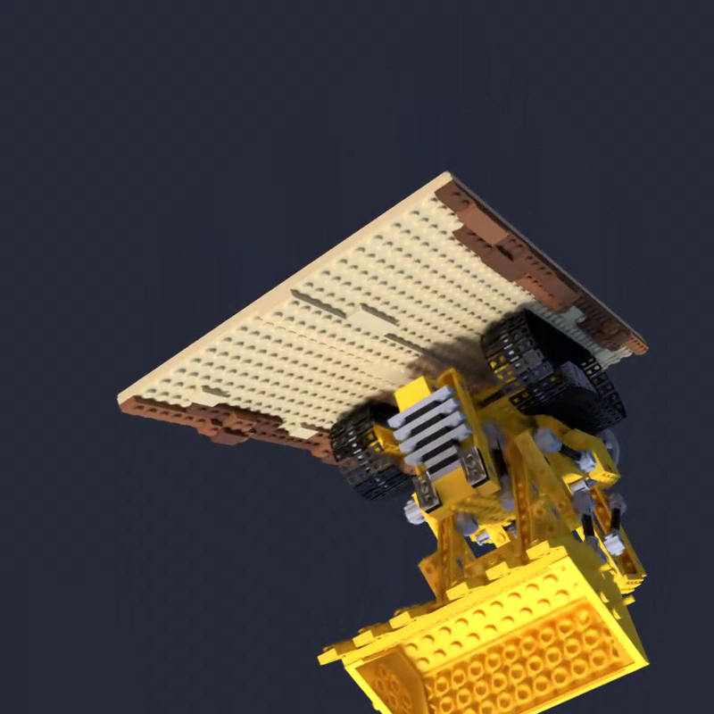
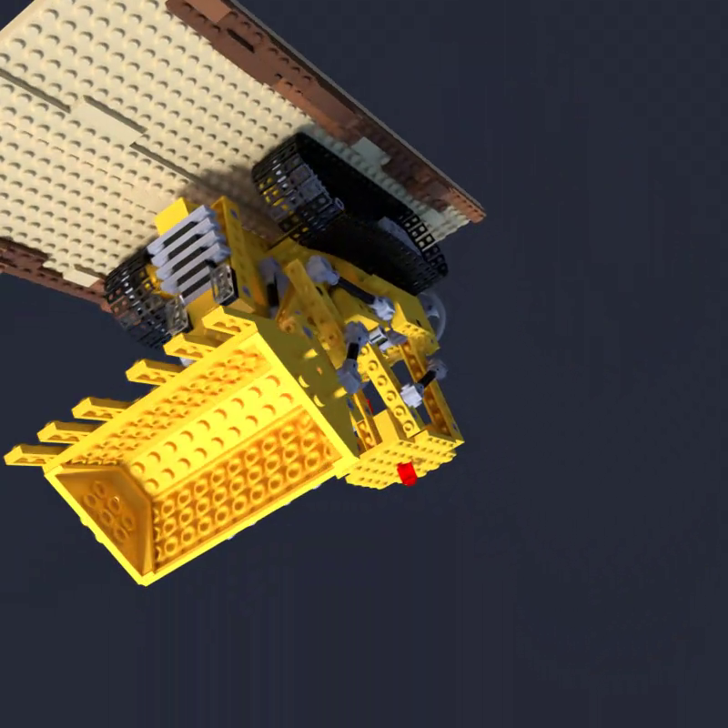

# 一台 16 GB 显存的本地 AI 工作站：实测记录

> 机器：AMD R5 3600（6C/12T，仅 AVX2）· 32 GB DDR4-3200 · **RTX 5060 Ti 16 GB**
> （Blackwell GB206 / sm_120）· Ubuntu 26.04 LTS · 内核 `7.0.0-30-generic`
> 驱动 `nvidia-driver-615-open 615.71.09`（CUDA UMD 13.4）
>
> 记录时间：2026-11-11 ~ 11-12

这套文档不是在讲"能跑什么"，而是**每一项都带实测数字和踩坑过程**，
方便拿到同款硬件的人少走弯路。

---

## 文档

| 文件 | 内容 |
| --- | --- |
| [`environment.md`](environment.md) | 完整环境清单：磁盘/网络/GPU 驱动/Python(uv)/Java/代理/大模型/出图/3D，14 节 |
| [`3d-gaussian-splatting.md`](3d-gaussian-splatting.md) | 3D 高斯泼溅专题：环境、用法、实测、10 个坑、能力边界 |
| [`disk-safety.md`](disk-safety.md) | 双系统机器上"NVMe 盘只读"的红线与自查方法 |

## 实测摘要

### 大模型（llama.cpp b6500 + Vulkan，全量卸载到显存）

| 模型 | prefill (pp512) | decode (tg128) |
| --- | ---: | ---: |
| Qwen3-8B Q4_K_M（4.7 GB） | 3086 tok/s | **74.1 tok/s** |
| Qwen3-0.6B Q8_0 | 21321 tok/s | 283.3 tok/s |

### 出图（ComfyUI）

| 任务 | 分辨率 / 步数 | 用时 | 显存峰值 |
| --- | --- | ---: | ---: |
| SDXL base | 1024² / 28 步 | 10.3 s | ~7 GB |
| Flux.1-schnell fp8 | 1024² / 4 步 | 7.8 s | 15.0 GB |
| Flux.1-schnell fp8 | 1280×720 / 4 步 | 8.0 s | **15.9 GB**（贴顶） |
| 局部重绘（inpaint） | 1280×720 | 8.4 s | 15.9 GB |

局部重绘的关键指标：**遮罩外像素最大差值 = 0**（逐像素保持原图不变）。

### 3D 重建（nerfstudio + gsplat）

| 项 | 值 |
| --- | ---: |
| 训练 10,000 迭代（136 帧 800×800） | **约 2 分钟** |
| 显存峰值 | 13.3 GB |
| 导出 `.ply` | 18 MB |
| 渲染 96 帧转台视频 | 约 20 秒 |

示例产物（`assets/`）：

转台视频：[`assets/lego_turntable.mp4`](assets/lego_turntable.mp4)

---

## 最有价值的几条经验

1. **Blackwell（sm_120）不是"装上就能用"**
   - Ubuntu 源里的 `nvidia-cuda-toolkit` 只有 **12.4**，编不出 sm_120
   - llama.cpp 官方**没有** Linux CUDA 预编译包 → 用 **Vulkan 版**，性能已很好
   - Python 生态必须用 cu128+ 的轮子：`pip install torch --index-url .../whl/cu130`
   - gsplat 这类要现编 CUDA 核的，得装 **CUDA 13 toolkit + gcc-14**（CUDA 13 不支持 gcc 15）

2. **`sshd` 的 `PermitListen` 是单值选项**
   写两行只有第一行生效，第二行被静默忽略。多个端口必须写在同一行：
   `PermitListen 127.0.0.1:22022 127.0.0.1:2222`
   （用 `sshd -T | grep permitlisten` 才能看到真相）

3. **装完驱动先把 GRUB 默认内核钉住**
   否则重启可能进到驱动未验证的新内核上，直接黑屏。

4. **USB 无线网卡会整条从总线掉线**
   `usb 2-3: USB disconnect` + `rtw88_usb`，之后没有任何默认路由，
   所有反隧道报 `Network is unreachable`，但机器"看起来什么都没干"。
   排查第一件事：`ip route | grep default` 和 `lsusb`。

5. **torch ≥2.6 的 `weights_only=True` 会打断老工具链**
   跑 nerfstudio 导出/渲染要加 `TORCH_FORCE_NO_WEIGHTS_ONLY_LOAD=1`。

6. **Qwen3 默认开思考模式**
   API 调用不加 `{"chat_template_kwargs": {"enable_thinking": false}}`，
   token 全花在 `reasoning_content`，`content` 返回空。

---

## 能力边界（16 GB 显存）

| 能做 | 做不到 |
| --- | --- |
| 8B/14B 模型全量进显存 | 70B |
| 32B Q4 部分卸载（8–15 tok/s） | 全参训练 / 多卡训练 |
| SDXL / Flux 1024–1280 出图、局部重绘 | Flux + 8B 同时驻留（>16 GB） |
| 场景级 3DGS（100–500 帧） | 城市级重建、4D 动态场景 |
| 语音 ASR/TTS、YOLO、SAM2、VLM-7B/8B | 1080p 长视频生成 |
