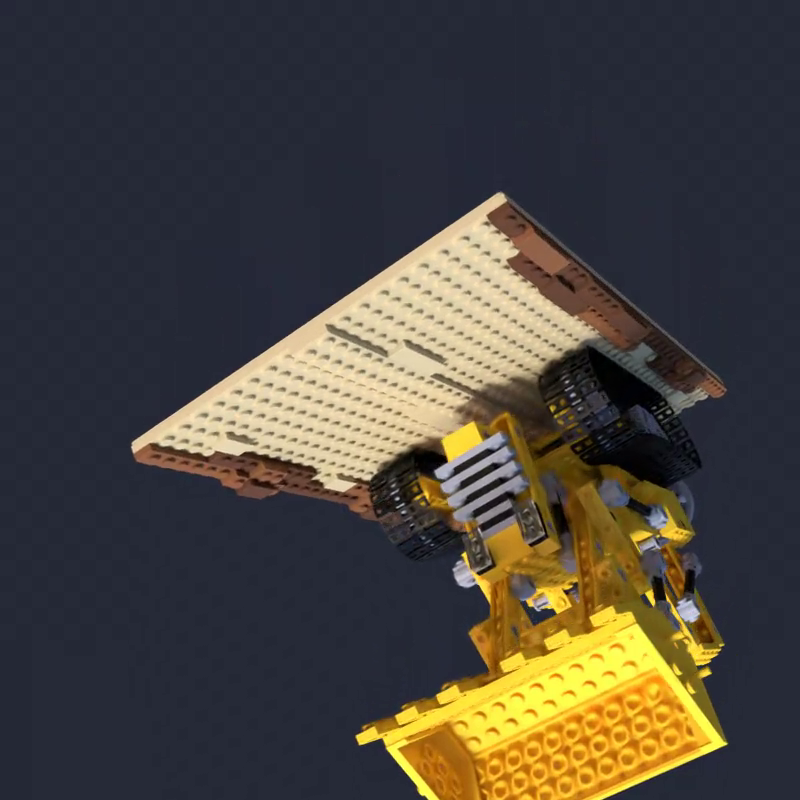
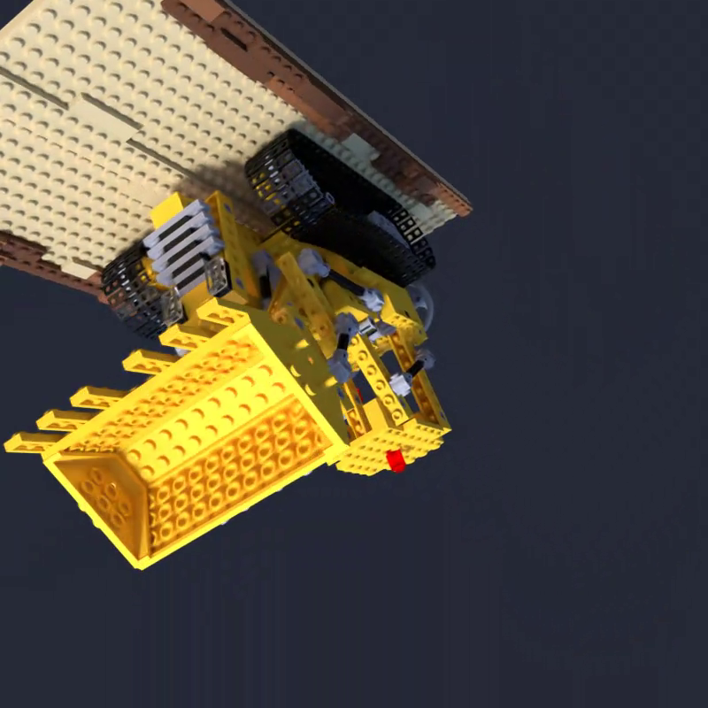

# 一台 16 GB 显存的本地 AI 工作站：实测记录

> 机器：AMD R5 3600（6C/12T，仅 AVX2）· 32 GB DDR4-3200 · **RTX 5060 Ti 16 GB**
> （Blackwell GB206 / sm_120）· Ubuntu 26.04 LTS · 内核 `7.0.0-30-generic`
> 驱动 `nvidia-driver-615-open 615.71.09`（CUDA UMD 13.4）
>
> 记录时间：2026-11-11 ~ 11-12

这套文档不是在讲"能跑什么"，而是**每一项都带实测数字和踩坑过程**，
方便拿到同款硬件的人少走弯路。

---

## 文档

| 文件 | 内容 |
| --- | --- |
| [`environment.md`](environment.md) | 完整环境清单：磁盘/网络/GPU 驱动/Python(uv)/Java/代理/大模型/出图/3D，14 节 |
| [`3d-gaussian-splatting.md`](3d-gaussian-splatting.md) | 3D 高斯泼溅专题：环境、用法、实测、10 个坑、能力边界 |
| [`camera-ai-filter.md`](camera-ai-filter.md) | K3/手机摄像头 → 逐帧 AI 滤镜（检测/背景替换/动漫/扩散），含实测与踩坑 |
| [`disk-safety.md`](disk-safety.md) | 双系统机器上"NVMe 盘只读"的红线与自查方法 |
| [`minimind-training.md`](minimind-training.md) | 从零训一个 30M 小模型：预训练 2.8 h / SFT 1.8 h，含吞吐实测与 CPU 上的 DDP 验证 |
| [`inference-acceleration.md`](inference-acceleration.md) | 推理加速三轮实测：量化七档 / KV 压缩 / 投机解码，全部带数字与负结果 |
| [`capability-internals.md`](capability-internals.md) | Wav2Lip / InsightFace / SDXL-LoRA 三项的内部原理与架构（含公式、踩坑、实测） |
| [`realtime-services.md`](realtime-services.md) | 实时链路实测：流式 ASR / Qwen3-VL 抽帧 / SAM2 分割 / CosyVoice2 诊断 |
| [`roofline-and-lora.md`](roofline-and-lora.md) | ncu roofline 实测（带宽 90% / 算力 50%）+ Qwen3-0.6B LoRA 微调 |
| [`serving-and-alignment.md`](serving-and-alignment.md) | 服务化与对齐：vLLM 多 LoRA / 前缀缓存曲线 / DPO / 视频理解 / VAD |
| [`deepseek-ocr.md`](deepseek-ocr.md) | DeepSeek-OCR 实测：视觉 token 压缩文档，单页 7.26s、去标签精度 83.5% |
| [`minicpm-o.md`](minicpm-o.md) | MiniCPM-o 4.5（9B 全模态）本机跑通：含 Linux 编译补丁与视觉实测 |
| [`tts-kokoro.md`](tts-kokoro.md) | TTS 横向：Kokoro-82M 可懂（RTF 0.55），胜过 CosyVoice2/MiniCPM-o 的语音输出 |
| [`e2e-and-opt.md`](e2e-and-opt.md) | 端到端：语音助手 3.33s / CUDA Graph +72-84% / Kokoro 上 K3（0.48× 实时） |
| [`rag-over-docs.md`](rag-over-docs.md) | 用自己的 77 篇文档搭 RAG：R@1 42%、端到端 709ms、四类失败分析 |
| [`stack-best-config.md`](stack-best-config.md) | 全优化叠加：单流 238 tok/s vs 64 并发 6,578 tok/s；ngram 交叉点在 8 并发 |
| [`rag-locate.md`](rag-locate.md) | 定位式 RAG：模型只指位置、程序抄原文；表格上下文从 4/12 救到 6/12 |

## 实测摘要

### 大模型（llama.cpp b6500 + Vulkan，全量卸载到显存）

| 模型 | prefill (pp512) | decode (tg128) |
| --- | ---: | ---: |
| Qwen3-8B Q4_K_M（4.7 GB） | 3086 tok/s | **74.1 tok/s** |
| Qwen3-0.6B Q8_0 | 21321 tok/s | 283.3 tok/s |

### 出图（ComfyUI）

| 任务 | 分辨率 / 步数 | 用时 | 显存峰值 |
| --- | --- | ---: | ---: |
| SDXL base | 1024² / 28 步 | 10.3 s | ~7 GB |
| Flux.1-schnell fp8 | 1024² / 4 步 | 7.8 s | 15.0 GB |
| Flux.1-schnell fp8 | 1280×720 / 4 步 | 8.0 s | **15.9 GB**（贴顶） |
| 局部重绘（inpaint） | 1280×720 | 8.4 s | 15.9 GB |

局部重绘的关键指标：**遮罩外像素最大差值 = 0**（逐像素保持原图不变）。

### 3D 重建（nerfstudio + gsplat）

| 项 | 值 |
| --- | ---: |
| 训练 10,000 迭代（136 帧 800×800） | **约 2 分钟** |
| 显存峰值 | 13.3 GB |
| 导出 `.ply` | 18 MB |
| 渲染 96 帧转台视频 | 约 20 秒 |

示例产物（`assets/`）：

转台视频：[`assets/lego_turntable.mp4`](assets/lego_turntable.mp4)

### 摄像头 AI 滤镜（K3 + 手机摄像头）

| 模式 | 推理/帧 | 输出 FPS | 显存 |
| --- | ---: | ---: | ---: |
| detect（YOLO11n） | 6.7 ms | 16.7（源上限） | 404 MiB |
| replace（分割换背景） | 21.1 ms | 16.75 | 442 MiB |
| blur（分割虚化） | 49.5 ms | 16.65 | 442 MiB |
| anime（AnimeGANv2） | 93.9 ms | 10.0 | 890 MiB |

链路：摄像头 → K3（MJPEG 8090）→ 千兆直连网线 → GPU 逐帧推理 → MJPEG 8091

> K3 的 USB 带宽只够跑一路摄像头（两路同时开会 `ENOSPC`），所以用
> `cam_select.sh usb|phone` 切换；手机作为 UVC 摄像头时只有 640×480@30。

---

### 小模型从零训练（minimind 30M）

| 项 | 实测 |
| --- | ---: |
| 预训练 30.03 M 参数 / 2 epochs | **2.8 小时**，loss 2.7 → 2.02 |
| SFT / 1 epoch（lr 1e-4） | **1.8 小时**，loss 1.9 → 1.4 |
| 预训练吞吐（batch 24 × seq 512） | **65,234 tok/s** |
| 权重文件 | 66.6 MB / 个（bf16） |
| 能力 | 会写代码、会自我介绍；**算不对 1+1** |

---

### 推理加速实测（Qwen3 + llama.cpp / transformers）

| 项目 | 实测结论 |
| --- | --- |
| 量化梯度（1.7B，F16→Q2 七档） | **Q4_K_M 最快：221.8 tok/s（F16 的 2.24×）**；Q2_K PPL +413% 不可用 |
| F16 有效带宽 | **402 GB/s = 448 GB/s 的 90%**（证明是带宽墙） |
| KV 压缩（kvpress，8K 上下文） | SnapKV@75% 省 12.6% 显存且检索不掉，但 **decode 速度几乎不变** |
| 投机解码（4 种实现） | 全部负收益 **0.53–0.73×**（接受率 67% 也没救回来） |
| 跨引擎对照（同模型同精度） | transformers 36.1 tok/s vs llama.cpp **98.8 tok/s（2.7×）** |

| 约束解码（xgrammar） | JSON 合法率 0/3 → **3/3**，每 token 只慢 7%，总耗时降 4.5× |
| FlexAttention（编译后） | 8K 滑窗比 SDPA 快 **3.64×**；不编译则慢 20–30×（math 回退） |
| Wanda 剪枝（0.6B） | 20% 稀疏仅 +0.9% PPL；随机剪 50% 崩到 PPL 178 万 |
| 引擎并发（vLLM） | 64 并发 **3,357 tok/s**（53.9× 单流），单流 62.3 |
| ngram 投机（vLLM） | 抄写类 **3.68×**，自由发挥 1.09×（零额外模型） |
| 长上下文 prefill | 2K 峰值 **13,357 tok/s**，32K 降到 5,686（-58%，attention O(L²)） |
| KV-FP8 / GPTQ-Int8 | KV-FP8 **+7.8%**；GPTQ-Int8 反而 **-26%**（内核未优化 sm_120） |
| 引擎原生结构化输出 | 合法率 0/4 → 4/4，token 数 200→45（总时间省约 4×） |
| 长上下文 decode | 16K 只掉 9%（59.8→54.4），有效带宽反升到 287 GB/s |
| K3 ngram 投机 | 端侧正收益：2.98 → 3.85 tok/s（**1.29×**），少线程时达 2.5× |
| 语音闭环（TTS→唇形→ASR） | faster-whisper-small：13.75 s 音频 **0.39 s 转写（34.9× 实时）**，CPU 3.1× |

---

## 最有价值的几条经验

1. **Blackwell（sm_120）不是"装上就能用"**
   - Ubuntu 源里的 `nvidia-cuda-toolkit` 只有 **12.4**，编不出 sm_120
   - llama.cpp 官方**没有** Linux CUDA 预编译包 → 用 **Vulkan 版**，性能已很好
   - Python 生态必须用 cu128+ 的轮子：`pip install torch --index-url .../whl/cu130`
   - gsplat 这类要现编 CUDA 核的，得装 **CUDA 13 toolkit + gcc-14**（CUDA 13 不支持 gcc 15）

2. **`sshd` 的 `PermitListen` 是单值选项**
   写两行只有第一行生效，第二行被静默忽略。多个端口必须写在同一行：
   `PermitListen 127.0.0.1:22022 127.0.0.1:2222`
   （用 `sshd -T | grep permitlisten` 才能看到真相）

3. **装完驱动先把 GRUB 默认内核钉住**
   否则重启可能进到驱动未验证的新内核上，直接黑屏。

4. **USB 无线网卡会整条从总线掉线**
   `usb 2-3: USB disconnect` + `rtw88_usb`，之后没有任何默认路由，
   所有反隧道报 `Network is unreachable`，但机器"看起来什么都没干"。
   排查第一件事：`ip route | grep default` 和 `lsusb`。

5. **torch ≥2.6 的 `weights_only=True` 会打断老工具链**
   跑 nerfstudio 导出/渲染要加 `TORCH_FORCE_NO_WEIGHTS_ONLY_LOAD=1`。

6. **Qwen3 默认开思考模式**
   API 调用不加 `{"chat_template_kwargs": {"enable_thinking": false}}`，
   token 全花在 `reasoning_content`，`content` 返回空。

7. **多卡训练先验逻辑，再验速度**
   在 CPU 上用 gloo 跑双进程，就能验证「梯度同步 / 参数同步 / 数据分片」三件事，
   零成本；租卡之后只剩下速度和通信开销要看。详见
   [`minimind-training.md`](minimind-training.md) 第 6 节。

---

## 能力边界（16 GB 显存）

| 能做 | 做不到 |
| --- | --- |
| 8B/14B 模型全量进显存 | 70B |
| 32B Q4 部分卸载（8–15 tok/s） | 全参训练 / 多卡训练 |
| SDXL / Flux 1024–1280 出图、局部重绘 | Flux + 8B 同时驻留（>16 GB） |
| 场景级 3DGS（100–500 帧） | 城市级重建、4D 动态场景 |
| 语音 ASR/TTS、YOLO、SAM2、VLM-7B/8B | 1080p 长视频生成 |
